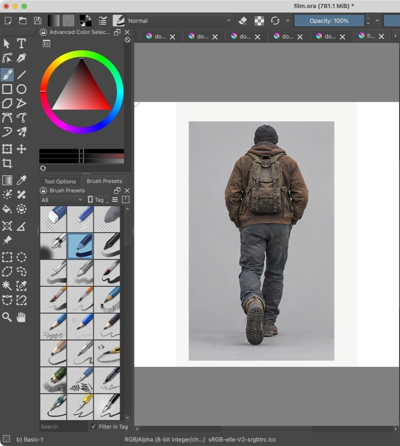
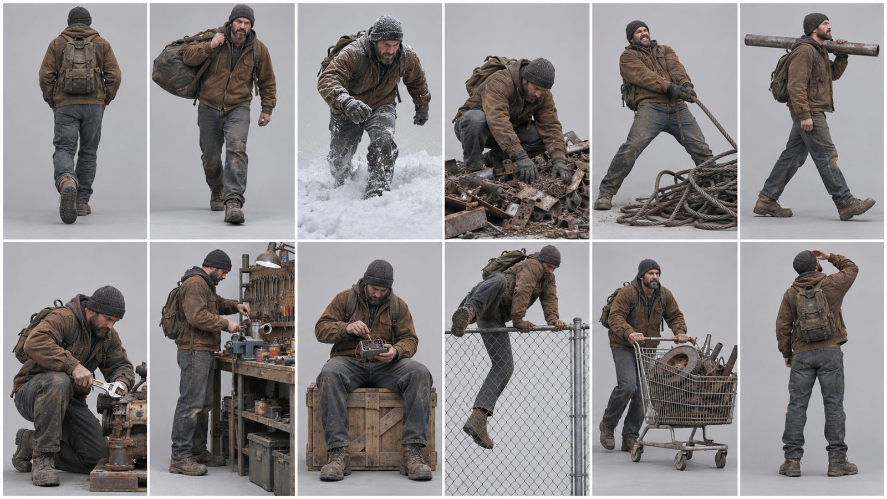
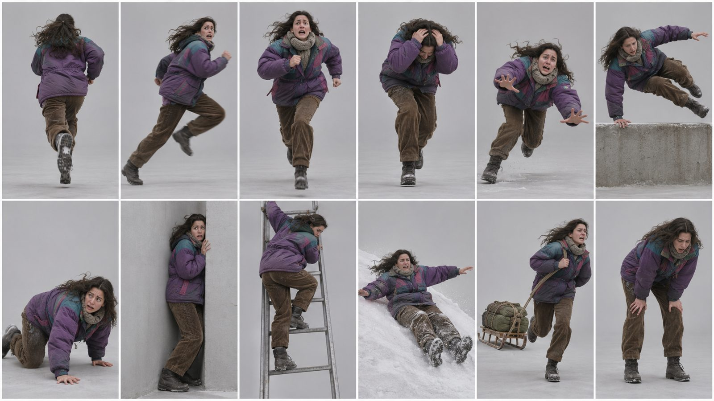
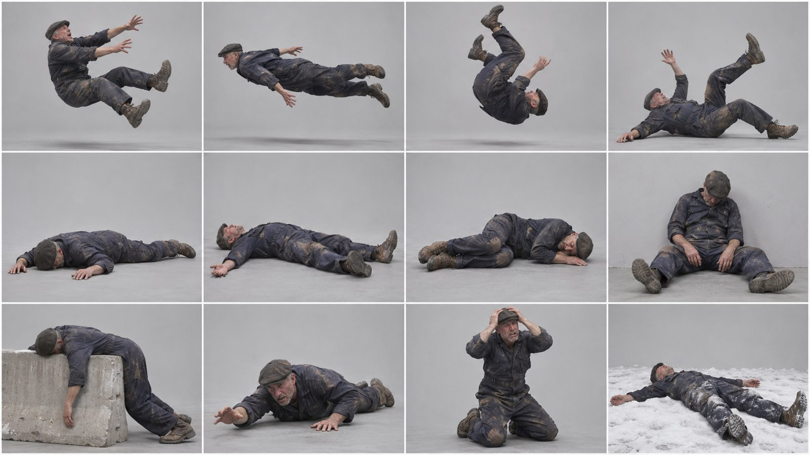
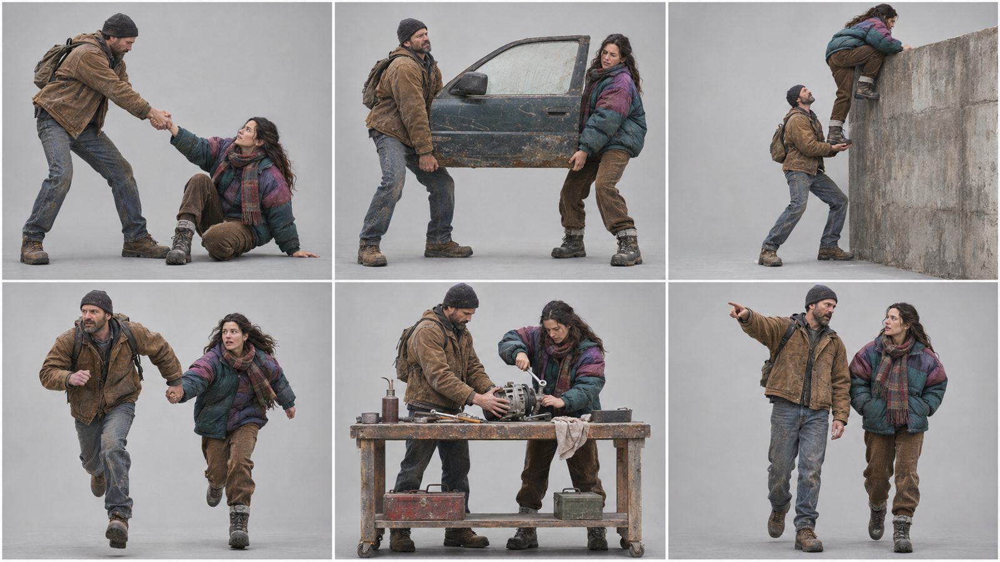
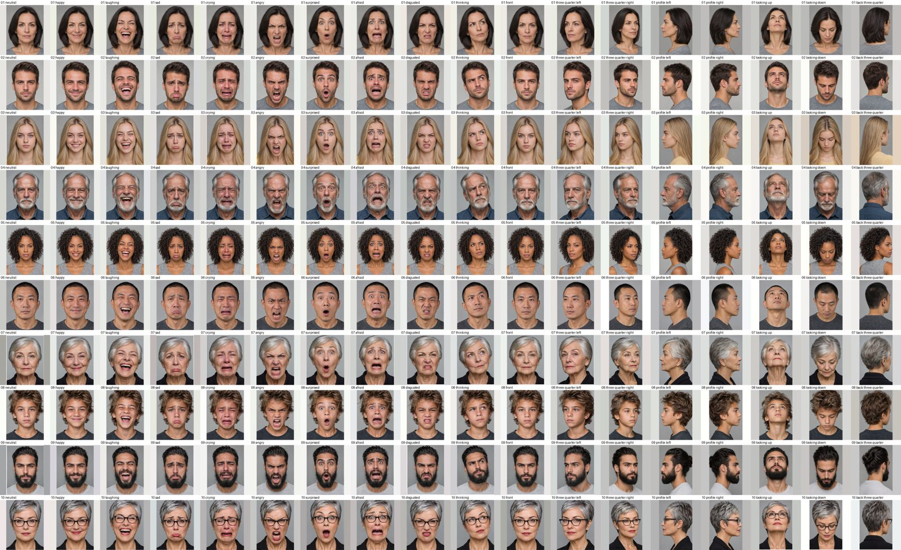
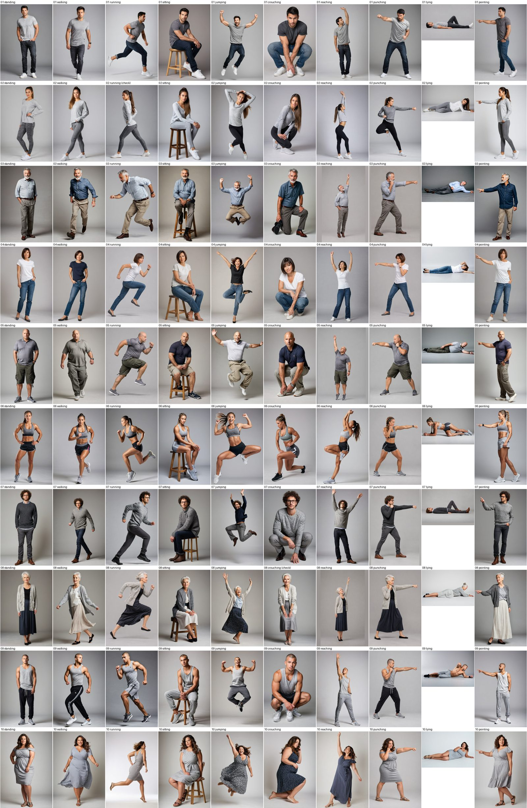
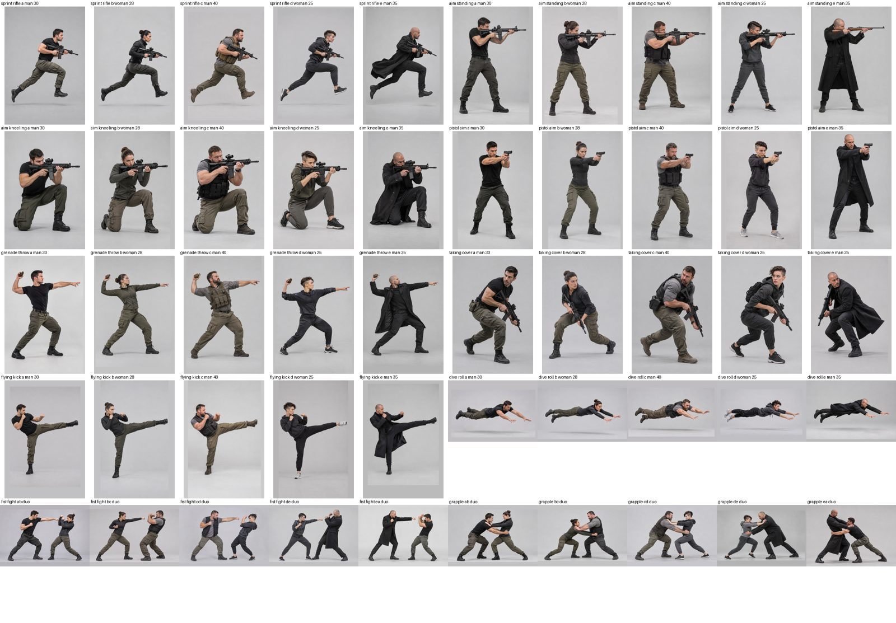

# Krita Stencils

Draw-over practice files for [Krita](https://krita.org): realistic reference photos of figures, faces and film poses, one per layer, grouped by person or scene. Open a file, show one photo, draw on top of it.

All people in these images are fictional and AI-generated.



## What's inside

| File | Stencils | What is in it |
|---|---|---|
| `out/film.ora` | 198 | 5 everyday characters in late 80s to mid 90s clothes: getting by (walking, scavenging, repairing, workbench), running away, blast and aftermath, plus two-person scenes |
| `out/faces.ora` | 180 | 10 people, each with 10 emotions and 8 head angles |
| `out/bodies.ora` | 100 | 10 body types in 10 everyday actions |
| `out/actions.ora` | 50 | 10 action scenes (rifle, pistol, grenade, cover, kick, dive, fist fight, grapple) for 5 characters |
| `out/*_contact.png` | | every stencil on one sheet, to pick one before opening a file |

The `.ora` files are in Git LFS: clone with `git lfs install` first, or download them from the file view.

### Film poses

Getting by:



Running away:



Blast and aftermath (stunt poses, no injuries):



Two people:



### Faces



### Bodies



### Action scenes



## How to practise

1. Open an `.ora` file in Krita. It keeps the groups and layers.
2. Only the first photo starts visible. Show the one you want and hide the rest.
3. Draw on the `draw here` layer at the top. Lower the photo layer's opacity to about 40% so your lines stand out.

A layer name ending in `(check)` failed the automatic pose check. It is kept, but look at it before trusting the anatomy.

## How it is made

The local parts run on a Windows GPU PC in the ComfyUI that Krita AI Diffusion starts (Krita must be open there), reached from the Mac through an ssh tunnel:

```bash
ssh -f -N -L 18188:127.0.0.1:8188 you@your-gpu-pc
```

- **Bodies** (`stencils/bodies.py`): RealVisXL V5 photo from a prompt, then OpenPose reads the pose back and `stencils/check.py` rejects anatomy errors (missing or cut-off limbs, wrong limb lengths, two people) and wrong actions (reaching without a hand above the head, lying with an upright torso). Up to 3 prompt retries, then 3 retries guided by a pose that already passed for another person (`work/pose_bank/`). (Traced outlines by PiDiNet were used at first; the files now hold the photos.)
- **Faces** (`stencils/faces.py`): neutral portrait per person with a fixed seed. Emotions rework that neutral photo (img2img, denoise 0.75), so framing and identity stay put. Angles are fresh generations from the same seed and description; an IP-Adapter face guide was tried and flattened every angle to front-facing.
- **Assembly** (`stencils/build.py`): writes the OpenRaster files and contact sheets.

The lists of people, actions, emotions and angles live in `stencils/specs.py`. To add one, edit the list and rerun the generator; finished tiles are skipped.

```bash
python3 stencils/bodies.py            # or a character slug, e.g. 03_man_60s
python3 stencils/faces.py             # or a person slug
python3 stencils/build.py
```

Retry flagged bodies with fresh seeds: delete nothing, run `SEED_OFFSET=50 python3 stencils/bodies.py`.

## GPT upgrade (photos)

`stencils/gpt_upgrade.py` makes images with Codex on the ChatGPT plan (about 55k plan tokens per image):

```bash
python3 stencils/gpt_upgrade.py bodies    # retry the flagged body tiles (pose-checked, needs the GPU PC tunnel)
python3 stencils/gpt_upgrade.py photos    # action scenes, one image each, framed on the figure
python3 stencils/gpt_upgrade.py faces     # GPT neutral from the local one, then 17 tiles from it
python3 stencils/build.py
```

Raw GPT images are kept in `work/gpt/`, so a stopped run resumes. Local tiles that were replaced are in `work/_old/`.

## Character sheets (GPT)

`stencils/gpt_sheets.py` asks GPT for one sheet holding 6 to 12 poses or faces of the same person, then cuts it at the white gutters, upscales each cell 4x on the GPU PC (NMKD Superscale) and places it as its own tile. One sheet costs about 42k plan tokens, the same as a single image.

```bash
python3 stencils/gpt_sheets.py film     # 3 sheets per film character (6x2, 6x2, 4x3)
python3 stencils/gpt_sheets.py duos     # one 3x2 two-person sheet per pair
python3 stencils/gpt_sheets.py faces    # 2 sheets per person: 10 emotions + 2 angles, then 6 angles
python3 stencils/gpt_sheets.py split    # needs Krita open on the GPU PC and the tunnel up
python3 stencils/build.py
```

## Decisions

- 2026-11-08: local models only (RealVisXL on the GPU PC). GPT via Codex was compared and gave cleaner face sheets but small full-body figures and no pose control; local was judged good enough and costs nothing per image.
- Hand-drawn pose skeletons were dropped: they made stiff figures. Poses now come from the prompt, checked after the fact.
- 2026-11-08: GPT (Codex) for all faces, the 18 bodies that failed the pose check, and a new action-scene set; local RealVisXL for the other bodies. GPT gave cleaner faces and got hard actions right.
- 2026-11-08: layers are the photos, not traced outlines. drawing goes straight over the photo, so tracing, its seam fixes and the per-image retries were dropped.
- 2026-11-09: GPT character sheets (12 poses per image) instead of one image per pose: 39 sheets gave 348 tiles for 1.4M plan tokens, and identity holds across a sheet. Faces are now all GPT, built from each person's local neutral portrait as the reference.
- 2026-11-09: the film set follows the films it is for (walking, scavenging, repairing, workbench, running away, blast aftermath) rather than combat. GPT refused the blast sheet for the 15-year-old, so that character has none.
